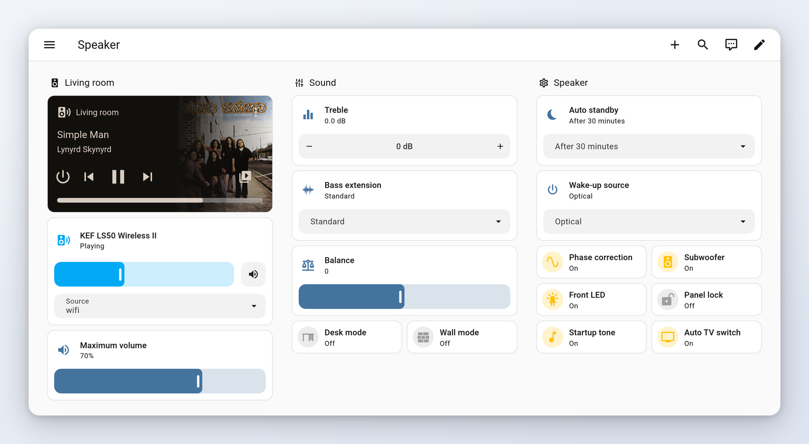
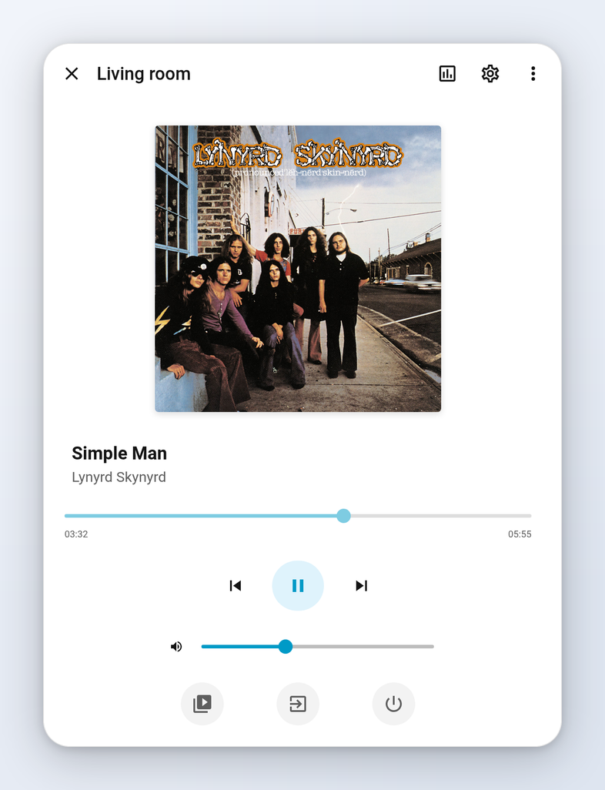
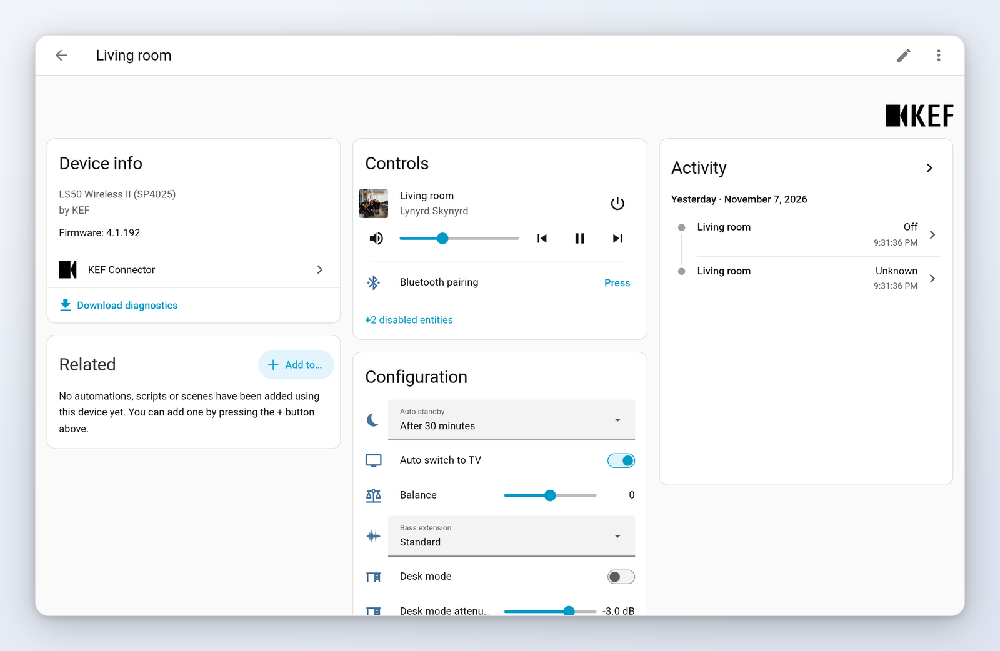

# KEF Connector

Home Assistant integration for KEF W2-platform wireless speakers: LS50 Wireless II, LS60 Wireless, LSX II, LSX II LT, XIO and LS LUXE. It talks to the speaker over the local network through [pykefcontrol](https://github.com/N0ciple/pykefcontrol), with no cloud involved.

  

  
  &nbsp;
  

## Features

- Local push: state changes appear as soon as the speaker reports them, no polling.
- Set up from the UI, speakers are found automatically through zeroconf.
- Media player with power, volume, mute, source selection, transport controls, play media and media browsing.
- EQ/DSP and speaker settings as entities, plus restart and Bluetooth buttons. Only what your model supports is created.
- Diagnostics download for bug reports.

Requires Home Assistant 2026.10.0 or newer.

## Documentation

Installation, configuration, the list of entities, examples, known limitations and troubleshooting are in the [full documentation](docs/documentation.md).

## Installation

With HACS or the Home Assistant Marketplace: click the first badge above, or search for "KEF Connector", download it and restart Home Assistant. Then add the speaker with the second badge, or from Settings > Devices & services (see the [documentation](docs/documentation.md#️-configuration)).

## Upgrading from 0.x

YAML configuration is no longer the way to set up the integration, but your existing `media_player: - platform: kef_connector` block is imported automatically at the first start: the entity is kept, so automations and dashboards keep working. Once the import has happened, Home Assistant shows a repair asking you to remove the YAML block; delete it from `configuration.yaml` and restart. YAML support will be removed around mid-2027.

Things that change: the speaker now appears as a device with additional entities, and the volume options are now in percent. See the [changelog](CHANGELOG.md). If you had renamed the media player entity yourself, Home Assistant now shows the device name in front of your custom name: check the name after upgrading and adjust it if needed.

## Troubleshooting

Download the diagnostics from the speaker's device page and see the [troubleshooting section](docs/documentation.md#️-troubleshooting) of the documentation. Report problems in the [issue tracker](https://github.com/N0ciple/hass-kef-connector/issues).

## Development

See [DEVELOPMENT.md](DEVELOPMENT.md). Licensed under Apache-2.0.
