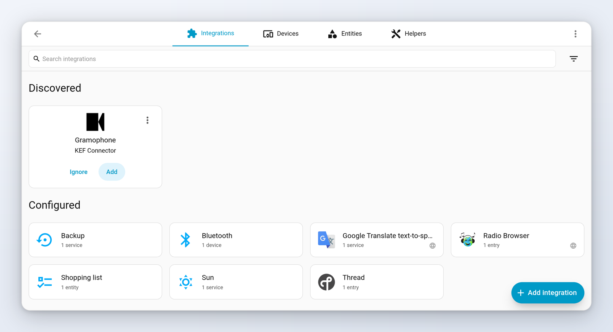
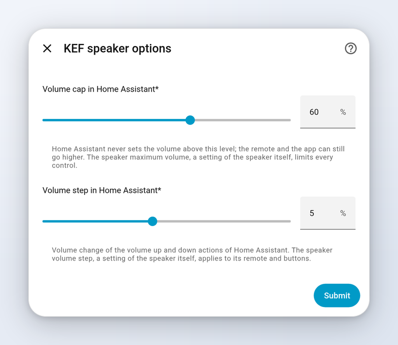
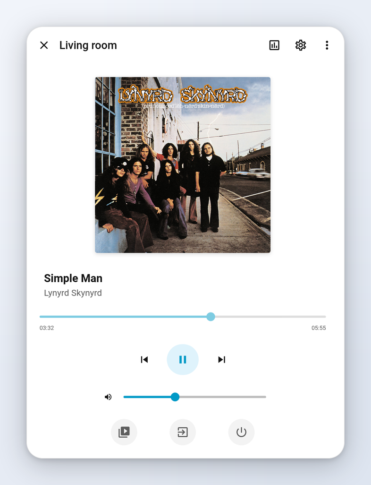

# 📖 KEF Connector documentation

Full guide to KEF Connector 1.0, the Home Assistant integration for KEF wireless speakers. For a quick
overview, see the [README](../README.md).

- [🔎 Overview](#-overview)
- [📦 Installation](#-installation)
- [⚙️ Configuration](#️-configuration)
- [🧩 Entities](#-entities)
- [🎵 The media player](#-the-media-player)
- [📡 Data updates](#-data-updates)
- [💡 Examples](#-examples)
- [⚠️ Known limitations](#️-known-limitations)
- [⬆️ Upgrading from 0.x](#️-upgrading-from-0x)
- [🛠️ Troubleshooting](#️-troubleshooting)
- [🗑️ Removal](#️-removal)

## 🔎 Overview

KEF Connector controls KEF speakers of the W2 platform from Home Assistant, over your local network.
There is no cloud and no account. It is built on [pykefcontrol](https://github.com/N0ciple/pykefcontrol).

You get a media player (power, volume, source, transport, play media, browsing) and the EQ/DSP and
speaker settings of the KEF Connect app as entities.

### Supported speakers

| Speaker | Status |
| --- | --- |
| LS50 Wireless II | supported, validated on firmware 4.1.192 |
| LS60 Wireless | supported |
| LSX II, LSX II LT | supported |
| XIO | supported |
| LS LUXE | supported |
| Coda W, Muo | not supported (Bluetooth only) |
| LS50 Wireless, LSX (first generation) | not supported, different API (see [aiokef](https://github.com/basnijholt/aiokef)) |

Home Assistant 2026.10.0 or newer is required.

## 📦 Installation

### HACS or Home Assistant Marketplace

[](https://my.home-assistant.io/redirect/hacs_repository/?owner=N0ciple&repository=hass-kef-connector&category=integration)

Click the badge, or search for "KEF Connector", download it and restart Home Assistant. Pre-releases are
only offered if you enable the pre-release switch.

### Manual

Copy the `custom_components/kef_connector` folder into the `custom_components` folder of your Home
Assistant configuration (or unzip `kef_connector.zip` from a release into
`custom_components/kef_connector`), then restart.

## ⚙️ Configuration

Everything is done from the UI.

### Automatic discovery

Speakers announce themselves with mDNS (zeroconf). A discovered speaker shows up in Settings > Devices &
services; click "Add" and confirm. Discovery needs mDNS to reach Home Assistant, so both must be on the
same subnet/VLAN (or you need an mDNS repeater). If the speaker's IP changes later, discovery updates it
by itself.

 Devices & services" width="70%">

### Adding a speaker by hand

[](https://my.home-assistant.io/redirect/config_flow_start/?domain=kef_connector)

Settings > Devices & services > Add integration > KEF Connector, then enter the speaker's IP address. You
find it in the KEF Connect app (speaker settings) or in your router. Use a **fixed IP** (DHCP reservation
in your router): it is the address Home Assistant talks to.

| Field | Description |
| --- | --- |
| Host | IP address of the speaker |

Only one entry per speaker is possible (the speaker is identified by its MAC address). Setup fails with
"cannot connect" if the speaker is off the network, or "does not look like a KEF wireless speaker" if the
address answers but is not a supported KEF.

### Changing the address

Settings > Devices & services > KEF Connector > ⋮ > Reconfigure, and enter the new address. It must be the
same speaker, otherwise the change is refused.

### Options

Settings > Devices & services > KEF Connector > Configure.



| Option | Default | Description |
| --- | --- | --- |
| Volume cap in Home Assistant | 100 % | Home Assistant never sets the volume above this level. The remote and the KEF app can still go higher. |
| Volume step in Home Assistant | 3 % | Volume change of the volume up/down actions (range 1 to 10 %). |

These only apply to volume changes made from Home Assistant. They are not the speaker's own settings,
which are separate entities: *Speaker maximum volume* (limits every control) and *Speaker volume step*
(for the remote and buttons).

## 🧩 Entities

Each speaker is a device with the entities below. An entity only exists if the speaker reports the
setting, so what you get depends on the model and firmware. "Off" in the *Default* column means the entity
is disabled by default: enable it from its settings in Home Assistant. Names are the English ones.

Entities in the *Configuration* category (most settings) do not appear on the default dashboard.

### Media player

One `media_player` entity named after the device. See [The media player](#-the-media-player).

### Switches

EQ switches follow the profile of the [current input](#️-known-limitations).

| Entity | What it does | Default | Condition |
| --- | --- | --- | --- |
| Desk mode | Compensates for desk reflections | on | EQ profile |
| Wall mode | Compensates for placement near a wall | on | EQ profile |
| Phase correction | Phase correction of the drivers | on | EQ profile |
| High-pass filter | Enables the high-pass filter | on | EQ profile |
| Subwoofer output | Enables the subwoofer output | on | EQ profile v2 |
| Dialogue mode | Boosts voices | on for XIO, off otherwise | speakers reporting it |
| Startup tone | Sound played when the speaker starts | on | model/firmware |
| Front LED | Status LED on the front (on means lit) | on | all |
| Front standby LED | Front LED while in standby (on means lit) | off | model/firmware |
| Top panel LED | LED of the touch panel | off | speakers with a top panel |
| Top panel standby LED | Same, in standby | off | speakers with a top panel |
| Top panel lock | Locks the top panel controls | on | speakers with a top panel |
| Auto switch to TV | Switches to TV when the TV turns on | on | speakers with a TV input |
| USB charging | USB port charges devices | on | model/firmware |
| Volume limit | Applies the speaker's maximum volume | on | all |
| Subwoofer always on | Keeps the subwoofer awake | off | model/firmware |

### Numbers

Ranges for EQ values come from the speaker.

| Entity | What it does | Default | Condition |
| --- | --- | --- | --- |
| Treble | Treble trim (dB) | on | EQ profile |
| Balance | Left/right balance | on | EQ profile |
| Desk mode attenuation | Strength of desk mode (dB) | on | EQ profile |
| Wall mode attenuation | Strength of wall mode (dB) | on | EQ profile |
| Subwoofer gain | Subwoofer level (dB) | on | EQ profile |
| Subwoofer low-pass frequency | Crossover towards the subwoofer (Hz) | on | EQ profile |
| High-pass frequency | High-pass cutoff (Hz) | on | EQ profile |
| Speaker maximum volume | Maximum volume of the speaker itself (%) | on | all |
| Speaker volume step | Step of the remote and buttons (1 to 10) | off | all |

### Selects

| Entity | What it does | Default | Condition |
| --- | --- | --- | --- |
| Bass extension | Less / Standard / Extra | on | EQ profile |
| Subwoofer preset | KEF subwoofer model, applies its crossover and gain like the app | on | EQ profile |
| Sound profile | Default, Music, Movie, Direct, Dialogue, Night | on | XIO, or speakers offering profiles |
| Auto standby | Never, after 20, 30 or 60 minutes | on | all |
| Wake-up source | Source used when the speaker wakes up (Default or an input) | on | all |
| Speaker connection | Wired or wireless link between a speaker pair | off | model/firmware |
| Primary speaker | Left, right or both channels | off | all |
| Favourite button | Action of the favourite button of the remote | off | speakers with the advanced remote |

### Buttons

| Entity | What it does | Default | Condition |
| --- | --- | --- | --- |
| Restart | Restarts the speaker | on | all |
| Reset DSP settings | Resets the EQ profile of the current input | on | EQ profile |
| Bluetooth pairing | Starts Bluetooth pairing | on | speakers with Bluetooth |
| Disconnect Bluetooth | Disconnects the Bluetooth device | off | speakers with Bluetooth |

### Binary sensors

| Entity | What it does | Default | Condition |
| --- | --- | --- | --- |
| Bluetooth connection | A Bluetooth device is connected (diagnostic) | off | speakers with Bluetooth |

## 🎵 The media player



### Features

| Feature | Notes |
| --- | --- |
| Turn on / off | On wakes the speaker on its last source, off puts it in standby |
| Volume set, up/down, mute | Set and step are limited by the [volume cap](#options) |
| Select source | Inputs depend on the model (Wi-Fi, Bluetooth, optical, USB, analog, TV...) |
| Play, pause, stop, next, previous | Only what the current source allows |
| Seek, shuffle, repeat | Only when the source allows it |
| Track info | Title, artist, album, cover, duration and position when the source gives them |
| Play media, browse media | See below |

States: `off` is standby, `on` is a physical input (optical, analog...), and `playing`, `paused`,
`buffering` or `idle` apply to the speaker's own player (Wi-Fi streaming, Bluetooth).

### Play media

`media_player.play_media` plays an audio stream URL or a media source item (radio, TTS...) directly on the
speaker, through its "custom radio" mechanism. It is simple on purpose: there is no queue and no
announcement with ducking. Use `media_content_type: music` (or `url`), and optionally a title:

```yaml
action: media_player.play_media
target:
  entity_id: media_player.living_room
data:
  media_content_type: music
  media_content_id: https://example.com/stream.mp3
  extra:
    title: My stream
```

For real file playback (local media, Plex/Jellyfin, track position), use Home Assistant's
[DLNA Digital Media Renderer](https://www.home-assistant.io/integrations/dlna_dmr/) or
[Google Cast](https://www.home-assistant.io/integrations/cast/) integration alongside this one: the speaker
is a DLNA renderer and a Cast device too. KEF Connector keeps handling power, source, volume and settings.

### Browsing

The media browser shows the audio items of your Home Assistant media sources. Cover art goes through Home
Assistant (it is proxied), so the speaker does not need to be reachable from your browser.

## 📡 Data updates

The integration is local push: it listens to the speaker's event queue (a long-poll connection), and does
not poll. A change made with the remote or the KEF app shows up in Home Assistant within about 0.1 s.

If the speaker disappears (power cut, network down), the entities become unavailable after about 40 s,
which is the long-poll timeout. Home Assistant reconnects by itself about 10 s after the speaker is back.

## 💡 Examples

### Turn on, choose a source, set the volume

If you enabled "default volume" in the KEF Connect app, the speaker sets its own volume after a source
change or a wake-up: [wait before setting yours](#️-known-limitations).

```yaml
actions:
  - action: media_player.turn_on
    target:
      entity_id: media_player.living_room
  - delay: "00:00:10"
  - action: media_player.select_source
    target:
      entity_id: media_player.living_room
    data:
      source: optical
  - delay: "00:00:02"
  - action: media_player.volume_set
    target:
      entity_id: media_player.living_room
    data:
      volume_level: 0.25
```

### Night mode

Switch to less bass in the evening (select entity ids are examples, check yours):

```yaml
triggers:
  - trigger: time
    at: "22:00:00"
actions:
  - action: select.select_option
    target:
      entity_id: select.living_room_bass_extension
    data:
      option: less
```

Remember that EQ entities act on the profile of the current input.

### Mute when the phone rings

```yaml
triggers:
  - trigger: state
    entity_id: sensor.phone_state
    to: ringing
actions:
  - action: media_player.volume_mute
    target:
      entity_id: media_player.living_room
    data:
      is_volume_muted: true
```

### Play an internet radio

```yaml
actions:
  - action: media_player.play_media
    target:
      entity_id: media_player.living_room
    data:
      media_content_type: music
      media_content_id: https://example.com/radio.mp3
      extra:
        title: My radio
```

## ⚠️ Known limitations

All measured on a real LS50 Wireless II.

- **EQ is per input.** The speaker keeps one EQ profile per input. EQ entities show and change the profile
  of the current input, and follow input changes.
- **Default volume overrides you.** With "default volume" enabled in the KEF Connect app, the speaker sets
  its own volume about 1 s after an input change and about 9 s after waking up. A volume set just before
  is overridden: add a delay in your automations (see the first example).
- **Turn on right after turn off is ignored.** Turning the speaker on within about 4 s after turning it
  off does nothing, the speaker is still going to standby.
- **Transport controls depend on the source.** For example there is no "previous" or shuffle/repeat on
  Deezer. The media player only shows what the source allows.
- **Physical inputs have no track information.** On TV, optical, coaxial, analog and USB inputs the
  speaker only reports the input name as title (for example `usb`): no artist, cover art or position.
- **Play media is basic.** No queue, no announce/ducking, see [Play media](#play-media).
- **Entities depend on the speaker.** They only exist when the speaker reports the setting, and some are
  disabled by default.

## ⬆️ Upgrading from 0.x

- Your `media_player: - platform: kef_connector` block is imported automatically at the first start. The
  entity is kept, so automations and dashboards keep working, and the options are converted to percent.
- Home Assistant then shows a repair asking you to remove the YAML block: delete it from
  `configuration.yaml` and restart. YAML support will be removed around mid-2027.
- The speaker is now a device with additional entities.
- If you had renamed the media player yourself, Home Assistant now shows the device name in front of your
  custom name. Check it and adjust.

See the [changelog](../CHANGELOG.md) for the full list.

## 🛠️ Troubleshooting

**Speaker not discovered.** Discovery relies on mDNS, so Home Assistant and the speaker must be on the same
subnet/VLAN (or use an mDNS repeater). Otherwise add it by IP address.

**Speaker unavailable or address changed.** Give the speaker a fixed IP (DHCP reservation). If it changed
anyway, use Reconfigure.

**Reporting a problem.** Download the diagnostics from the device page (⋮ > Download diagnostics) and
attach them to your report. For debug logs, add this to `configuration.yaml`, restart, reproduce, then
download the full log from Settings > System > Logs:

```yaml
logger:
  default: warning
  logs:
    custom_components.kef_connector: debug
    pykefcontrol: debug
```

**Model not working as expected.** Run the library's command line tool and attach its output:

```shell
pip install pykefcontrol
pykefcontrol diag <ip>
```

Report problems in the [issue tracker](https://github.com/N0ciple/hass-kef-connector/issues).

## 🗑️ Removal

1. Settings > Devices & services > KEF Connector > ⋮ > Delete.
2. Remove the integration with HACS (or the Marketplace), then restart. For a manual install, delete the
   `custom_components/kef_connector` folder.
3. If you still have a `media_player: - platform: kef_connector` block in your YAML configuration, delete
   it, otherwise it would be imported again.
